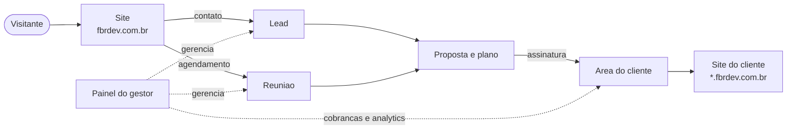
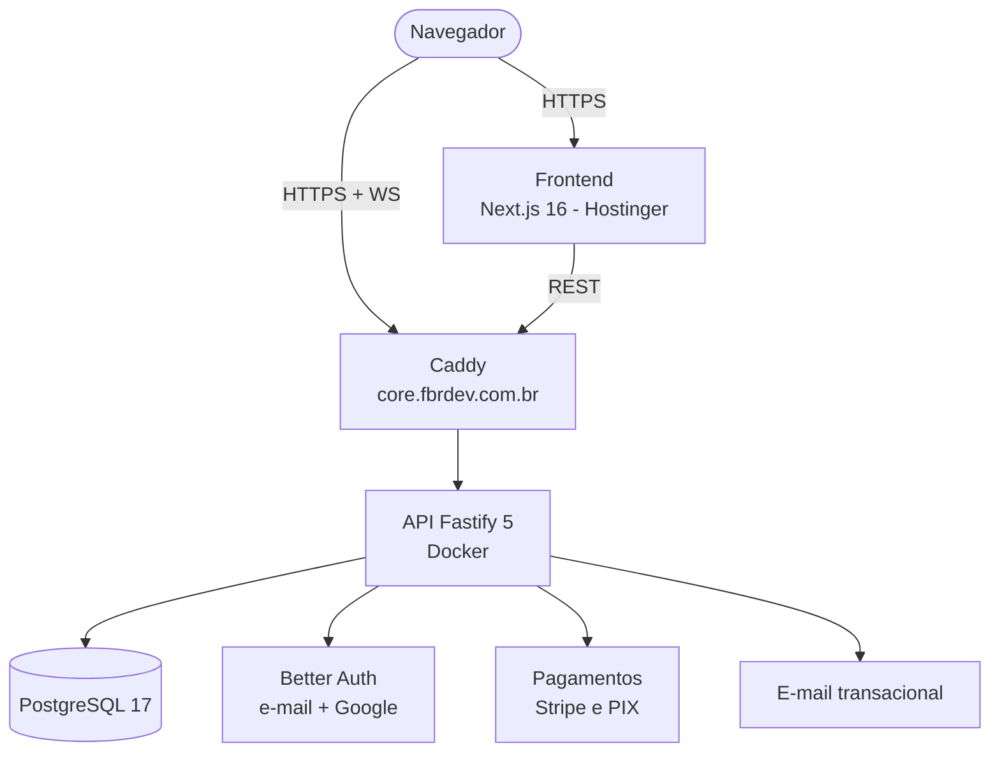
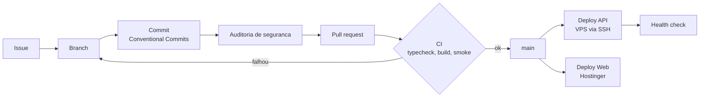

<h1 align="center">FBR.Dev Technology</h1>

  Sites, sistemas e produtos digitais sob medida. Do primeiro contato ao site no ar.
   
  <a href="https://fbrdev.com.br"><strong>fbrdev.com.br</strong></a>

---

## O que fazemos

| Frente | Entrega |
|---|---|
| Sites institucionais | Next.js com SSG/SSR, Lighthouse 95+, WCAG 2.2 AA |
| Plataformas SaaS | Area do cliente, painel do gestor, planos e assinaturas |
| Hospedagem gerenciada | Sites de clientes em subdominios `*.fbrdev.com.br` com TLS |
| Privacidade | Consentimento, retencao e descarte conforme a LGPD |

## Stack

| Camada | Tecnologia |
|---|---|
| Frontend | Next.js 16 (App Router), React 19, TypeScript, CSS Modules |
| API | Node.js 24, Fastify 5, Better Auth, Kysely, Zod, WebSockets |
| Dados | PostgreSQL 17, migrations SQL-first |
| Infra | Docker, Caddy (TLS automatico), Hostinger, VPS |
| Qualidade | GitHub Actions, typecheck, smoke tests, auditoria de seguranca |

## Fluxo da plataforma

## Arquitetura

## Como trabalhamos

---

FBR.Dev Technology - Brasil

